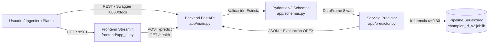

# BBVA Facility Management — Smart HVAC OPEX API (wx-energy-ops)

**Versión de Entrega:** `v1.0.0` | **Modelo:** `v2.0-champion-rf` (*Random Forest*) | **Umbral Operativo:** `u = 0.30`
**Autor:** Sergio Eduardo de la Vega Herrera — Maestría en Inteligencia Artificial (Universidad Tecmilenio)

Microservicio MLOps contenerizado para la detección temprana de **Sobreconsumo Energético Crítico HVAC** (>= 66.64 kWh/m2, P80) en inmuebles corporativos y sucursales bancarias, optimizando el presupuesto operativo (**OPEX**).

---

## 1. Arquitectura de la Solución



---

## 2. Guía de Ejecución Rápida en Menos de 15 Minutos (Prueba en Frío)

### Prerrequisitos
* **Docker** (>= 24.0) o **Python** 3.11+
* Puerto local `8000` (API) y `8501` (Frontend) disponibles.

### Opción A: Ejecución con Docker (Recomendada para Producción)
```bash
# 1. Clonar el repositorio y entrar al directorio (1 min)
git clone https://github.com/sergie-delavega/wx-energy-ops.git
cd wx-energy-ops
git checkout v1.0.0

# 2. Construir la imagen Docker multi-etapa sin privilegios root (3 min)
docker build -t wx-energy-ops:v1.0.0 .

# 3. Levantar el contenedor en segundo plano (1 min)
docker run -d --name bbva-hvac-api -p 8000:8000 -e MODEL_THRESHOLD=0.30 wx-energy-ops:v1.0.0

# 4. Verificar estado del contenedor y logs
docker ps
docker logs bbva-hvac-api
```

### Opción B: Levantar Backend + Frontend juntos con Docker Compose
```bash
docker compose up --build -d
```
* **Swagger UI (API Interactiva):** `http://localhost:8000/docs`
* **Frontend Ejecutivo Streamlit:** `http://localhost:8501`

---

## 3. Ejemplos de Peticiones y Respuestas (cURL)

### 3.1 Verificación de Salud (GET /health)
```bash
curl -X GET http://localhost:8000/health
```
**Respuesta esperada (HTTP 200 OK):**
```json
{
  "status": "healthy",
  "service": "wx-energy-ops-api",
  "model_loaded": true,
  "model_version": "v2.0-champion-rf",
  "active_threshold": 0.30,
  "uptime_seconds": 42.15
}
```

### 3.2 Predicción de Sobreconsumo Crítico (POST /predict)
```bash
curl -X POST http://localhost:8000/predict -H "Content-Type: application/json" -d '{"Compacidad_Relativa": 0.79, "Area_Superficie": 637.0, "Area_Pared": 343.0, "Area_Techo": 147.0, "Altura_Total": 7.0, "Orientacion": 2, "Area_Acristalamiento": 0.40, "Distribucion_Acristalamiento": 2}'
```
**Respuesta esperada (HTTP 200 OK):**
```json
{
  "prediccion_clase": 1,
  "etiqueta_operativa": "Sobreconsumo Crítico HVAC (Alerta Activa)",
  "probabilidad_critico": 0.9804,
  "umbral_aplicado": 0.30,
  "version_modelo": "v2.0-champion-rf",
  "evaluacion_opex": {
    "accion_recomendada": "Despachar cuadrilla para inspección termográfica y ajuste de setpoints",
    "costo_inspeccion_usd": 250.0,
    "riesgo_fuga_fn_usd": 2500.0,
    "beneficio_neto_esperado_usd": 2201.01
  },
  "latencia_ms": 18.42
}
```

---

## 4. Ejecución de Pruebas Automatizadas (pytest)
```bash
pytest
```
